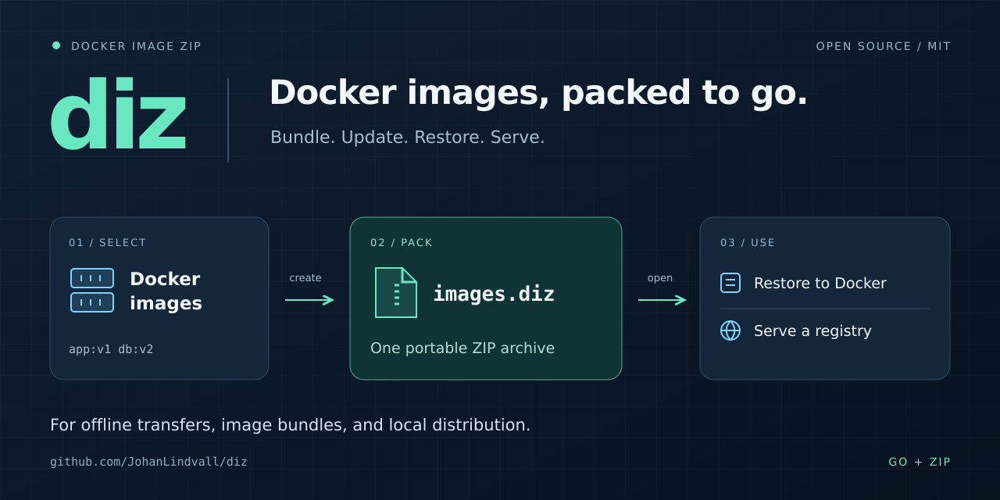

# diz



[](https://github.com/JohanLindvall/diz/actions/workflows/ci.yml)
[](https://github.com/JohanLindvall/diz/actions/workflows/codeql.yml)
[](go.mod)
[](LICENSE)

**Bundle Docker images into a portable ZIP. Update the bundle, restore selected images, or serve it as a local registry.**

diz is a small Go CLI for moving images between machines, preparing offline environments, and keeping a set of image tags in one file. It uses standard ZIP compression and keeps image data, manifests, and content hashes together.

[Quickstart](#quickstart) · [Command reference](docs/cli.md) · [Archive format](docs/archive-format.md) · [Contributing](CONTRIBUTING.md)

## Why diz?

- **Pack the images you need.** Select tags with globs or keep the list in a tag file.
- **Carry a single archive.** Copy the `.diz` file to another machine and restore selected images with diz.
- **Reuse compressed entries.** When updating a bundle, retained ZIP entries are copied without decompression and recompression.
- **Serve images straight from a file.** Start a small read-only registry backed by the archive.
- **Inspect with familiar tools.** A `.diz` file is a ZIP archive; `unzip -l images.diz` lists its contents.

| Task | Command |
| --- | --- |
| List matching local images | `diz list 'alpine:*'` |
| Create a bundle | `diz create images.diz 'alpine:*'` |
| Inspect a bundle's image tags | `diz -fromzip images.diz list '*'` |
| Restore selected images | `diz -fromzip images.diz restore 'alpine:*'` |
| Refresh images in a new bundle | `diz update images.diz next.diz 'alpine:*'` |
| Serve a bundle as a registry | `diz serve images.diz` |

## Install

With [Go 1.25 or newer](https://go.dev/doc/install):

```sh
go install github.com/JohanLindvall/diz@latest
```

Go installs the executable into `GOBIN`, or `$(go env GOPATH)/bin` when `GOBIN` is unset. Add that directory to your `PATH`, then run `diz -h`.

To build a checkout instead:

```sh
git clone https://github.com/JohanLindvall/diz.git
cd diz
go build -o ./bin/diz .
./bin/diz -h
```

CI builds and runs race tests on Linux, macOS, and Windows. Creating archives from Docker and restoring images require a running Docker Engine. Listing, copying, and serving existing archives do not require a running daemon.

## Quickstart

Start with one image:

```sh
docker pull alpine:3.24
diz create images.diz alpine:3.24
diz -fromzip images.diz list '*'
```

The last command prints:

```text
alpine:3.24
```

Copy `images.diz` to another machine with diz and Docker installed, then restore:

```sh
diz -fromzip images.diz restore '*'
docker image inspect alpine:3.24
```

Put flags **before** the command and quote globs so your shell does not expand them. Pass `'*'` explicitly to select every image. Use diz to restore `.diz` files; `docker load` expects a Docker archive, not a diz ZIP.

## Update a bundle

After pulling or building a new version of an image locally:

```sh
docker pull alpine:3.24
diz update images.diz next.diz 'alpine:*'
```

The new file retains the other image tags and replaces matching tags with the local versions. Existing entries carried into the new archive keep their compressed bytes. Always use a **different output filename**; updates do not happen in place.

You can also create a smaller bundle from an existing archive:

```sh
diz -fromzip images.diz create alpine-only.diz 'alpine:*'
```

## Serve a local registry

```sh
diz serve images.diz
```

In another terminal on the same machine:

```sh
docker pull localhost:5000/alpine:3.24
```

The server currently listens on **all interfaces at port 5000**, using HTTP without authentication. Use it on a trusted local network; consult the [registry guide](docs/cli.md#serve) before sharing it with other machines.

## Keep an image list

Store exact image references in a text file, with optional keys and comments:

```text
# images.txt
base=alpine:3.24
web=nginx:alpine
```

Then build a bundle, pulling images that are missing locally:

```sh
diz -pull -tagfile images.txt create images.diz
```

See [tag files and digest rewriting](docs/cli.md#tag-files) for keeping deployment references aligned with a locally served bundle.

## How it works

diz reads Docker's image export stream and stores its files under `.diz/` in a ZIP archive. A `.hashes` index records SHA-256 hashes of file contents. Large entries use a parallel DEFLATE writer; archive-to-archive copies can reuse compressed entries directly.

The [format guide](docs/archive-format.md) explains the file layout, compatibility boundaries, and parallel compression. The current workflow has been exercised with Docker Engine 29.8.2 using its classic image store. The project does not currently claim support for preserving multi-platform image indexes.

## Get involved

Questions, reproducible bug reports, documentation improvements, and measured performance results are welcome. Start with the [contribution guide](CONTRIBUTING.md) or [open an issue](https://github.com/JohanLindvall/diz/issues/new/choose).

Maintained by [Johan Lindvall](https://github.com/JohanLindvall). Please follow the [code of conduct](CODE_OF_CONDUCT.md). Report vulnerabilities through the [security policy](SECURITY.md).

## License

[MIT](LICENSE).
